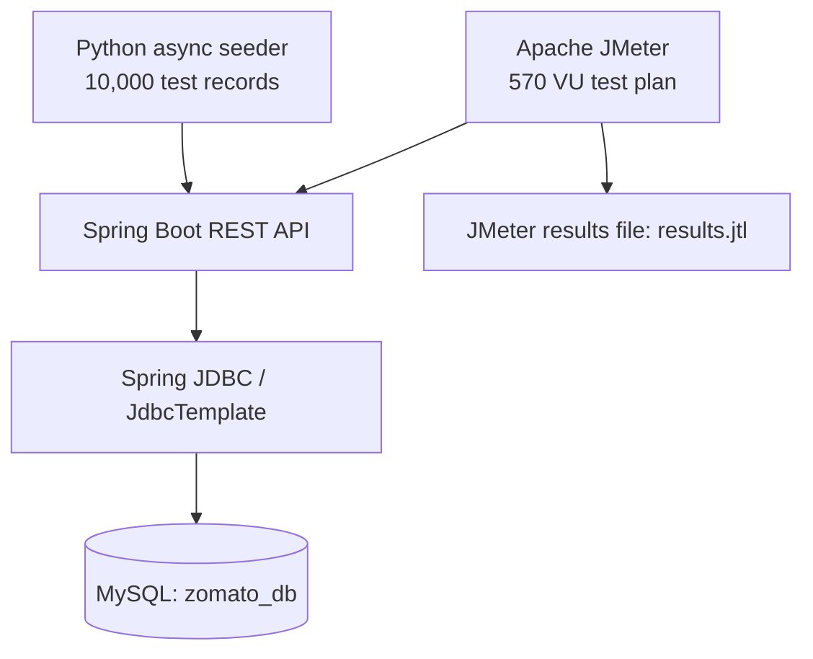

# Load Testing in Java

A performance-testing playground for a restaurant management REST API built with **Java 17, Spring Boot and MySQL**. The repository combines a JDBC-backed API, an asynchronous Python data-seeding utility and an Apache JMeter test plan.

> **Scope note:** The JMeter plan is configured for up to **570 concurrent virtual users (VUs)** across four thread groups. This is a test configuration, not a claim that a particular throughput or latency was achieved. Add measured results from your own test run before publishing benchmark claims.

## Project at a glance

| Area | Implementation |
|---|---|
| Backend API | Java 17, Spring Boot 3.2.5 |
| Data access | Spring JDBC / JdbcTemplate |
| Database | MySQL |
| Load testing | Apache JMeter 5.6.3 |
| Test data | Python, asyncio, aiohttp |
| Build | Maven |

## Architecture



The API exposes restaurant CRUD and search operations. The list endpoint supports pagination using `page` and `size` query parameters (defaults: page `0`, size `20`; maximum size: `100`). The Python utility seeds test data through the API, and JMeter exercises read, create and search workloads.

## Features

- REST endpoints to create, read, update, delete and search restaurants.
- JDBC-based persistence using Spring's `JdbcTemplate`.
- JMeter test plan with four workload groups and a combined configuration of up to 570 VUs.
- Python asynchronous data seeding for 10,000 restaurant records.
- Configurable seeding concurrency, batch size and retry attempts.
- JMeter result export to a `.jtl` file for analysis.

## API endpoints

Base URL: `http://localhost:8080`

| Method | Endpoint | Purpose |
|---|---|---|
| `GET` | `/api/restaurants?page=0&size=20` | List restaurants with pagination (page starts at 0; size 1–100) |
| `GET` | `/api/restaurants/{id}` | Fetch a restaurant by ID |
| `POST` | `/api/restaurants` | Create a restaurant |
| `PUT` | `/api/restaurants/{id}` | Update a restaurant |
| `DELETE` | `/api/restaurants/{id}` | Delete a restaurant |
| `GET` | `/api/restaurants/search?name={term}` | Search by name |

### Paginated listing example

```http
GET /api/restaurants?page=0&size=20
```

The response includes the current page content and metadata: `page`, `size`, `totalElements`, `totalPages`, `first` and `last`.

Invalid page values and page sizes outside 1–100 return a `400 Bad Request`. Invalid request bodies return structured validation details. Unexpected server errors return a generic message rather than exposing internal exception details.

## Load-test configuration

The `zomato_load_test.jmx` plan contains these thread groups:

| Workload | Configured VUs | Ramp-up | Duration |
|---|---:|---:|---:|
| List all restaurants | 500 | 10 seconds | 60 seconds |
| Fetch by ID | 30 | 10 seconds | 60 seconds |
| Create restaurant | 20 | 10 seconds | 60 seconds |
| Search restaurants | 20 | 10 seconds | 60 seconds |
| **Total configured concurrency** | **570** | | |

The plan is read-heavy, with GET-all, GET-by-ID, POST and search requests. Actual throughput, latency and error rate depend on the machine, database, JVM configuration and test environment.

## Prerequisites

Install the following before running the project:

- JDK 17
- Maven (or use the Maven Wrapper if one is added to the repository)
- MySQL
- Python 3.8+
- Python package: `aiohttp`
- Apache JMeter 5.6.3 (for load testing)

## Run locally

### 1. Create the database

Create the database in MySQL:

```sql
CREATE DATABASE zomato_db;
```

### 2. Configure the database password

The application connects to a local MySQL instance and reads the password from the `DB_PASSWORD` environment variable. Set it before starting the application.

**Windows PowerShell**
```powershell
$env:DB_PASSWORD="your_mysql_password"
```

**macOS / Linux**
```bash
export DB_PASSWORD="your_mysql_password"
```

The current datasource URL and username are in `loadtesting/src/main/resources/application.properties`. Update those values if your MySQL host, port or username differs.

### 3. Start the Spring Boot API

From the repository root:

```bash
cd loadtesting
mvn spring-boot:run
```

The API should be available at `http://localhost:8080`.

### 4. Install the Python dependency

From the repository root:

```bash
python -m pip install aiohttp
```

### 5. Seed test data

With the API running, open another terminal at the repository root:

```bash
python seed_data.py
```

The script is configured to submit 10,000 records in batches of 100, with up to 20 concurrent requests and up to three attempts per record.

### 6. Run the JMeter plan

From the repository root:

```bash
jmeter -n -t zomato_load_test.jmx -l results.jtl
```

To open the results in the JMeter GUI:

```bash
jmeter
```

Then load the generated `results.jtl` file in a listener such as **Summary Report** or **Aggregate Report**.

## Automated tests

The project includes JUnit 5 and Mockito unit tests for the service layer, covering CRUD delegation, missing records, search and pagination metadata.

Run the test suite from the application directory:

```bash
cd loadtesting
mvn test
```

## Benchmark results

No benchmark numbers are published in this repository yet. After running the test, record the environment and measured values here rather than relying on the configured VU count.

| Metric | Measured result |
|---|---|
| Test machine / CPU / RAM | Add your environment |
| Database version and configuration | Add your environment |
| Configured virtual users | 570 |
| Throughput (requests/second) | Add from JMeter |
| Average response time | Add from JMeter |
| p95 response time | Add from JMeter |
| p99 response time | Add from JMeter |
| Error rate | Add from JMeter |
| Test duration | 60 seconds per thread group |

For a meaningful comparison, keep the test environment and workload constant between runs. Include the JMeter `.jtl` output or a sanitized report when sharing results.

## Repository structure

```text
.
├── loadtesting/
│   ├── pom.xml
│   └── src/main/
│       ├── java/com/loadtesting/
│       │   ├── App.java
│       │   ├── AppConfig.java
│       │   ├── Restaurant.java
│       │   ├── RestaurantController.java
│       │   ├── RestaurantRepository.java
│       │   └── RestaurantService.java
│       └── resources/
│           ├── application.properties
│           └── schema.sql
├── seed_data.py
├── zomato_load_test.jmx
└── README.md
```

## Future improvements

- Add automated integration tests for the REST endpoints.
- Externalize database URL and username as environment variables as well.
- Add repeatable benchmark runs and publish measured JMeter reports.
- Compare query and connection-pool configurations under the same workload.
- Add a CI workflow to build and test the Spring Boot application.

## License

MIT
